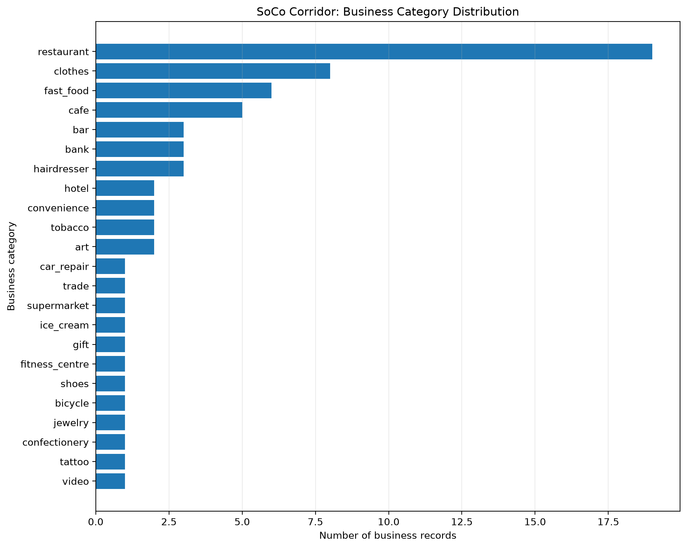
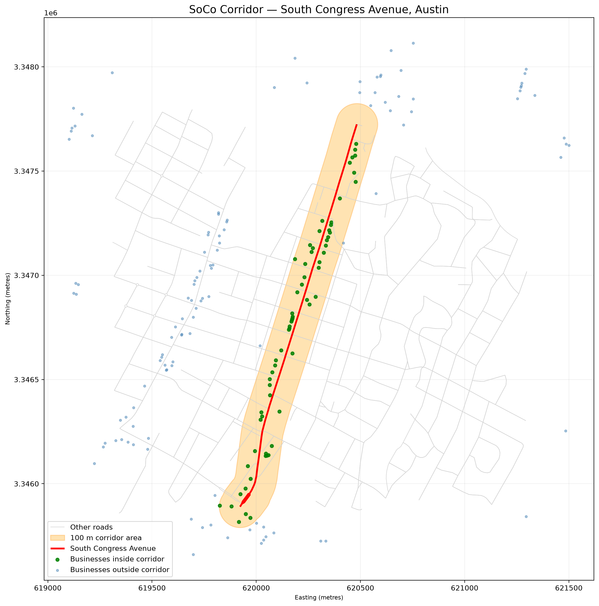

# SoCo Corridor Analysis — Final Report

## 1. Project objective

This project uses road-network and business-location data to
analyse the commercial character of the South Congress Avenue
(SoCo) area in Austin, Texas.

The workflow identifies business clusters, matches businesses
to nearby roads, constructs a preliminary road-based corridor,
and summarises the businesses within the selected area.

## 2. Methodology

1. Load the available road-network and business-location data.
2. Cluster business locations and rank candidate commercial areas.
3. Match businesses to nearby road segments.
4. Select road records named South Congress Avenue.
5. Merge the selected road geometries where possible.
6. Buffer the selected road geometry by 100 metres on
   each side.
7. Count business records whose points fall inside that buffer.
8. Calculate category diversity and business records per kilometre.

## 3. Corridor results

| Metric | Result |
|---|---:|
| Selected road records | 44 |
| Connected road components | 4 |
| Merged centerline length | 1.993 km |
| Buffer on each side | 100 m |
| Buffered area | 0.4174 sq km |
| Business records inside | 67 |
| Business records outside | 116 |
| Categories inside corridor | 23 |
| Business records per km | 33.62 |

The density metric is calculated as the number of business records
inside the buffer divided by the merged centerline length.

## 4. Business category distribution

The most common categories in the selected corridor are:

| category    |   business_records |
|:------------|-------------------:|
| restaurant  |                 19 |
| clothes     |                  8 |
| fast_food   |                  6 |
| cafe        |                  5 |
| hairdresser |                  3 |
| bar         |                  3 |
| bank        |                  3 |
| tobacco     |                  2 |
| hotel       |                  2 |
| art         |                  2 |

## 5. Data quality checks

| Check | Result |
|---|---:|
| Business records inside corridor | 67 |
| Unique named businesses | 60 |
| Missing or blank business names | 6 |
| Records sharing a repeated name | 2 |
| Distinct category labels, including Unknown | 23 |

Repeated names are flagged for review, not automatically removed.
Two legitimate businesses may have the same name. Likewise,
unnamed records may still represent real businesses.

### Repeated names to review

- Mission Burger Co.

## 6. Corridor map

## 7. Interpretation

The current dataset shows a substantial food-and-dining presence,
alongside retail and service businesses. Category counts describe
the records available in this dataset; they should not be treated
as a complete census of every business in the SoCo district.

The buffered road geometry provides a reproducible first definition
of the corridor for analysis.

## 8. Limitations

- The corridor uses a chosen 100-metre buffer, not an official
  district boundary.
- The merged geometry contains 4 disconnected components.
  These sections should be checked before claiming the corridor is
  one continuous road.
- The merged line length may differ from the sum of original road
  segment lengths because segments may overlap or be disconnected.
- Business names, categories, missing values, and duplicates may
  require further verification.
- Business records inside the buffer depend on the completeness and
  accuracy of the source data.
- The category-based analysis describes the available records and
  does not establish customer demand or business performance.

## 9. Output files

- `soco_corridor_map.png` — corridor and business map
- `soco_corridor_area.geojson` — buffered corridor polygon
- `soco_corridor_centerline.geojson` — merged road geometry
- `soco_corridor_businesses.csv` — selected business records
- `soco_corridor_summary.csv` — corridor metrics
- `soco_category_counts.csv` — category counts
- `soco_business_category_chart.png` — category distribution chart
- `soco_data_quality_summary.csv` — data quality summary

## 10. Conclusion

The project has progressed from business clustering to a
preliminary road-based commercial corridor with mapped business
locations, category statistics, and reproducible output files.

The current results are suitable for an initial corridor analysis.
Road continuity and business data quality remain important checks
before treating the measurements as final verified facts.
